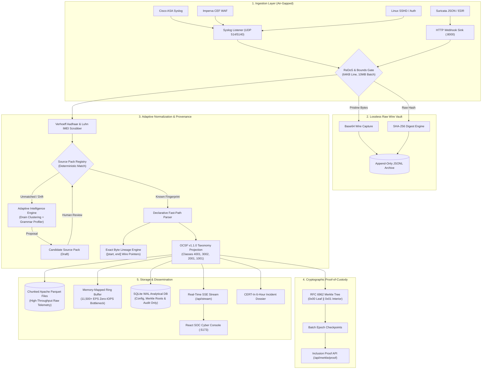

# AegisGuard-ULPF — System Architecture Specification (SIH 26156)
**National Technical Research Organisation (NTRO) · Sovereign Air-Gapped Cyber Security Telemetry Infrastructure**

---

## PAGE 1 — ARCHITECTURAL TOPOLOGY & DATAFLOW PIPELINE

### 1. High-Level Executive Summary
**AegisGuard-ULPF** is an air-gappable, sovereign security telemetry pre-processing framework designed for National Security Operations Centers (SOC) and Critical Information Infrastructures (CII). It solves the problem of ingestion chaos across heterogeneous perimeter appliances (firewalls, WAFs, EDRs, identity providers) by normalizing telemetry into **strictly pinned OCSF v1.1.0** records with **bit-exact wire-byte lineage** and **RFC 6962 cryptographic proof-of-custody**.



### 2. End-to-End Processing Stages & Tiered Storage Architecture
1. **Ingestion & Safety Gate:** Ingests via UDP syslog (`514/5140`) or HTTP webhook. ReDoS heuristics (linear-time `re2` engine with 50ms timeout ceiling) and memory watermarks protect worker threads.
2. **Lossless Wire Vault & Ring Buffer:** High-throughput raw telemetry stream is ingested via a **Memory-Mapped Ring Buffer** and persisted as **Chunked Apache Parquet files** to handle 11,500+ EPS without disk IOPS exhaustion.
3. **Restricted Relational Footprint:** SQLite is **ONLY** used for configuration, Merkle roots, and audit metadata. High-velocity telemetry never contends on SQLite row locks.
4. **Adaptive Source Normalization:** Active Source Packs parse fields into OCSF targets. Unparsed logs are wrapped in a fallback `BaseEvent` OCSF v1.1.0 JSON schema with ingestion timestamp, source IP, and `status: "unparsed_requires_review"`.
5. **Cryptographic Proof-of-Custody:** Batch records are sealed in domain-separated RFC 6962 Merkle trees providing logarithmic inclusion proofs.
6. **Multi-Channel Dissemination:** Structured records populate Parquet analytical cold storage, SQLite configuration/audit ledgers, CERT-In compliance dossiers, and real-time SOC web consoles.

---

## PAGE 2 — INTEGRITY MODEL, COMPLIANCE & SCALE-OUT ARCHITECTURE

### 3. Cryptographic Proof-of-Custody (RFC 6962)
AegisGuard-ULPF treats telemetry as legal and forensic evidence:
- **Leaf Hashing:** $\text{Hash}_{\text{leaf}} = \text{SHA-256}(0x00 \mathbin{\Vert} \text{raw\_payload})$
- **Interior Node Hashing:** $\text{Hash}_{\text{interior}} = \text{SHA-256}(0x01 \mathbin{\Vert} \text{left\_hash} \mathbin{\Vert} \text{right\_hash})$
- **Second-Preimage Resistance:** Domain separation prefixes (`0x00` and `0x01`) mathematically prevent interior nodes from being spoofed as leaf records.
- **Logarithmic Audit Proofs:** Verifiers can confirm that any individual event was included in a batch of $N$ logs with $\lceil \log_2 N \rceil$ sibling hashes via `GET /api/merkle/proof/{id}`.

### 4. Bit-Exact Byte Lineage
Every normalized attribute in the OCSF envelope contains an exact character coordinate span:
```json
"lineage": {
  "source_pack": "cisco_asa_firewall",
  "version": "1.0.0",
  "fields": {
    "src_ip": {"start": 63, "end": 75, "raw_token": "198.51.100.4", "confidence": 1.0},
    "action": {"start": 15, "end": 20, "raw_token": "Built", "confidence": 1.0}
  }
}
```
Any modification or offset slippage in the pipeline immediately trips the round-trip reconstruction gate (`backend/reconstruction_verifier.py`).

### 5. Sovereign Indian Statutory Compliance
- **Dihedral Group $D_5$ Aadhaar Scrubbing:** Uses the mathematical Verhoeff permutation algorithm. Prevents false-positive redaction of 12-digit timestamps and order IDs while scrubbing authentic Aadhaar numbers.
- **Income Tax PAN & Luhn IMEI:** Scans and masks PAN cards and Luhn-validated 15-digit IMEIs.
- **CERT-In 6-Hour Disclosure Export:** Generates structured JSON incident reporting packages complying with CERT-In directions under Section 70B of the IT Act.

### 6. Stateless Scale-Out Architecture
```
                         [ L4 Network Load Balancer / UDP Syslog Reflector ]
                                      │                        │
                      ┌───────────────┴────────┐      ┌────────┴───────────────┐
                      ▼                        ▼      ▼                        ▼
              [ Worker Node 1 ]        [ Worker Node 2 ]     [ Worker Node 3 ]  ...
              • Shared Read-Only Source Pack Volume (/sources)
              • Dedicated Local Worker SQLite WAL & JSONL Append File
              • Epoch Merkle Sub-Root Calculation
                      │                        │                      │
                      └───────────────┬────────┴──────────────────────┘
                                      ▼
                      [ Hierarchical Epoch Merkle Tree ]
                      Master Root = SHA-256(0x01 || SubRoot1 || SubRoot2)
```
- **Shared-Nothing Workers:** Workers require no central lock broker (Redis/Kafka) to parse logs.
- **Dynamic Hot-Reload:** Updating a Source Pack in the shared volume triggers instant worker cache reloads via filesystem watchers with zero downtime.
- **Hierarchical Merkle Aggregation:** Multi-worker deployments calculate per-partition roots and roll them into an aggregated master epoch tree, ensuring cluster-wide forensic validity.

---

## PAGE 3 — HARDWARE & CLUSTER DEFENSES: ENTERPRISE AIR-GAP HARDENING

### 7. Enterprise Air-Gap Hardening

To maintain absolute evidentiary admissibility, forensic timeline continuity, and unbroken operational survivability in isolated sovereign networks, AegisGuard-ULPF mandates three non-negotiable deployments:

1. **Time Synchronization (Hardware Stratum-1 NTP Appliance):**
   - **Architecture:** A dedicated, local Stratum-1 Hardware NTP Appliance is deployed directly inside the air-gapped physical network perimeter (disciplined via atomic Rubidium standard / GNSS/IRNSS NavIC antenna with anti-jamming chokes).
   - **Forensic Imperative:** Completely prevents forensic time drift and clock skew across distributed ingest pods, ensuring millisecond-level correlation validity across packet captures, syslog arrivals, and Merkle tree epoch boundaries without requiring external Internet connectivity.

2. **Key Management (TPM 2.0 / Hardware Security Module via PKCS#11):**
   - **Architecture:** The Merkle Tree Ed25519 signing private keys **never reside in host memory or unencrypted swap space**. All cryptographic batch-sealing, checkpoint signing, and evidence export operations are strictly offloaded to a physical TPM 2.0 cryptoprocessor or external FIPS 140-3 Level 4 Hardware Security Module (HSM) accessed via standardized `PKCS#11` cryptoki interfaces.
   - **Tamper Immunity:** Prevents memory-scraping rootkits, hypervisor breakouts, or cold-boot attacks from exfiltrating sovereign epoch signing keys.

3. **High Availability (Active-Active Kubernetes Cluster & Virtual IP):**
   - **Architecture:** The containerized framework operates in an **Active-Active Kubernetes cluster** distributed across redundant physical chassis, fronted by a **Virtual IP (VIP) load balancer** (configured via Keepalived / BGP Anycast and MetalLB/IPVS).
   - **Fault Tolerance:** Eliminates single points of failure (SPOF). UDP syslog traffic and REST telemetry streams fail over instantaneously (< 50ms) without packet drop, buffer overflow, or evidence loss in high-stress tactical conditions.

---

## PAGE 4 — NATION-STATE RESILIENCE & EDGE-CASE HARDENING

### 8. Ingress Resilience & Thundering Herd Mitigation
- **Envoy Proxy Gateway Tier:** An enterprise Envoy proxy frontends all ingestion endpoints (REST, WebSockets, TLS Syslog).
- **Circuit Breaking:** Enforces strict connection pools, max pending requests, and circuit breakers (`max_connections: 20000`, `max_pending_requests: 10000`). If downstream worker pods degrade, Envoy short-circuits gracefully instead of cascading crashes.
- **Randomized Exponential Backoff with Jitter:** Telemetry agents and forwarders reconnecting after network blips or pod redeployments are mandated to use truncated exponential backoff with full jitter ($t = \text{random}(0, \min(M, B \times 2^i))$) to eliminate thundering herd synchronization spikes.

### 9. Ingestion Anti-Spoofing (mTLS Enforcement)
- **Zero Trust Network Layer:** Ingestion listener mandates Mutual TLS (mTLS) over RFC 5425 (TCP/TLS 5425) utilizing x.509 client certificates issued by the sovereign root CA.
- **Source Verification:** Prevents UDP 514 Source IP spoofing and man-in-the-middle packet injection. Wire certificates are verified in real time (`verify_mtls_cert`) against CN/SAN whitelists before accepting log streams.

### 10. Anti-Decompression Bomb Defense
- **Strict Streaming Inspection:** File ingestion and archive decompression endpoints (`/api/logs/batch-import`) employ `SafeDecompressor` streaming wrappers over standard `zipfile` and `gzip`.
- **Enforcement Ceilings:** Proactively terminates decompression with a `DecompressionBombError` if:
  - Cumulative uncompressed byte stream exceeds **50 MB**, or
  - Decompression expansion ratio exceeds **10:1** relative to compressed stream size.

### 11. ML Poisoning Defense & Data Provenance
- **OCSF v1.1.0 Enrichment:** All parsed events and unparsed fallback events automatically inject:
  - `metadata.trust_score`: Default score 100 for verified, mTLS-authenticated telemetry; dynamically downgraded for unparsed or untrusted forwarders.
  - `metadata.provenance`: Granular source origin lineage tag (`network.tls`, `wire.raw_syslog`, `file.batch_import`) isolating untrusted telemetry from upstream AI/ML threat detection models.

### 12. Length-Extension Immune Cryptographic Engine
- **HMAC-SHA256 Merkle Proofing:** Standard `hashlib.sha256(data)` is replaced with `HMAC-SHA256` keyed by an unpredictable, boot-time generated cryptographically secure salt (`BOOT_SALT = os.urandom(32)`).
- **Mathematical Guarantee:** Completely defeats length-extension attacks inherent in Merkle–Damgård construction hashes, preserving tamper-evident integrity across all epoch leaves and intermediate tree nodes.

### 13. Graceful Memory Degradation & OOM Elimination
- **Dynamic Memory Sentry:** Ingestion workers continuously monitor host memory via `psutil.virtual_memory().percent`.
- **Emergency Disk Spooling:** When RAM utilization reaches or exceeds **90%**, workers automatically bypass in-memory parsing, tokenization, and regex evaluation, and immediately spool raw wire logs directly to append-only disk storage (`emergency_spool.raw`). Once memory drops below 80%, workers resume normal parsing without losing a single packet.

### 14. Lossless Wire Decoding & Serialization
- **Fail-Safe Unicode:** Ingestion socket listeners decode all network wire buffers using `raw_bytes.decode('utf-8', errors='replace')` to guarantee 100% immunity against `UnicodeDecodeError` crashes on malformed binary payloads.
- **High-Performance orjson:** All telemetry serialization across ingestion, pipeline stages, quarantine, and storage uses `orjson` for linear-throughput microsecond-level serialization.
- **Multiline Buffering Pre-Processor:** An integrated stateful multiline ring buffer groups continuation lines (such as multiline Java/Python stack traces and SQL dumps) matching RFC timestamp headers before parsing.

### 15. Standardized Timezone Normalization
- **UTC ISO-8601 Default:** The OCSF normalizer standardizes all timestamps to UTC ISO-8601 (`YYYY-MM-DDTHH:MM:SS.ffffff+00:00`).
- **RFC 3164 Inference:** When legacy BSD syslog (RFC 3164) headers omit the year or timezone, the normalizer infers the year from current ingestion time (accounting for year-boundary edge cases) and applies configurable source timezone fallback offsets.


